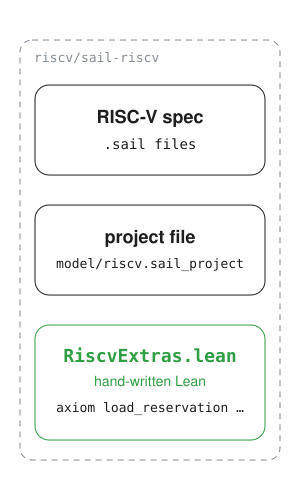
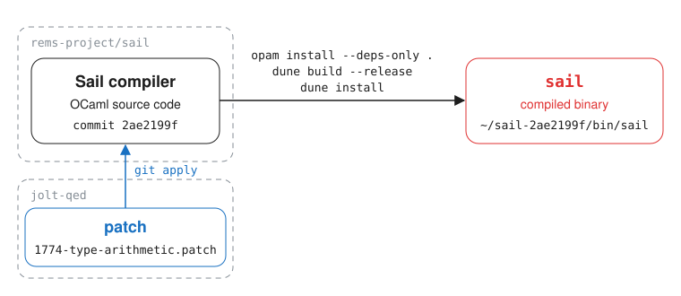
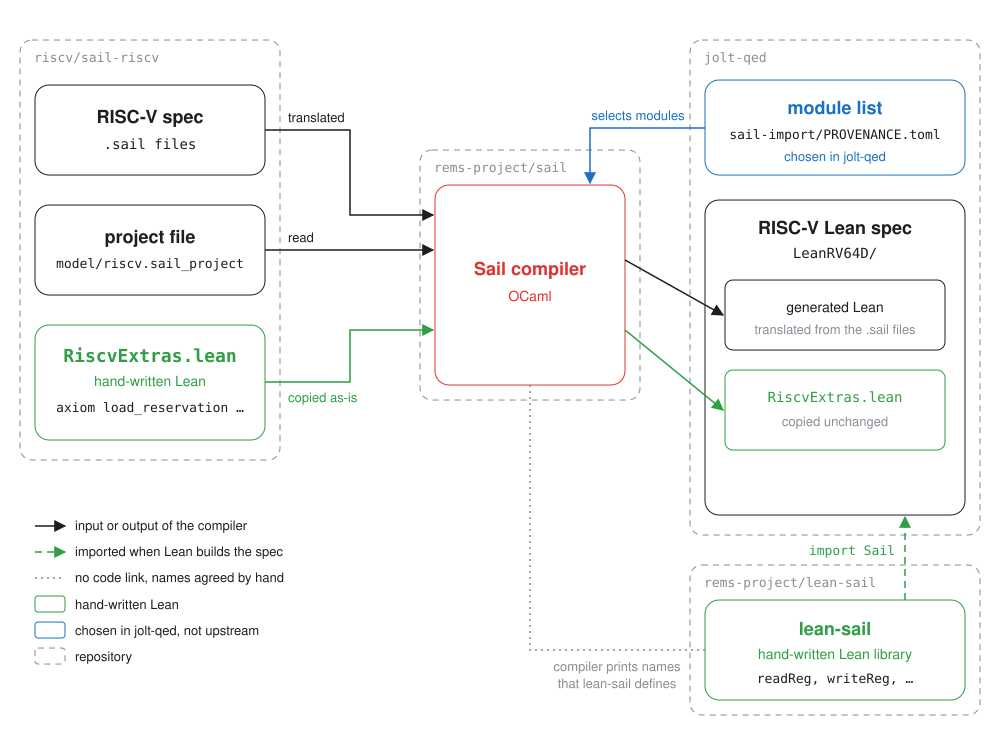

+++
title = "Sail To Lean Translation"
date = 2026-11-03
draft = true

[extra]
hidden = false

[taxonomies]
authors = ["ari"]
tags = ["jolt-qed", "notes"]
+++

Since we started this project in April of 2026, there have been improvements to Lean and the Sail compiler.
[Quang Dao](https://quangvdao.github.io/) generously took the time to port our project to use Lean version 4.35 and a later version of the Sail compiler ([PR #36](https://github.com/LayerZero-Labs/jolt-qed/pull/36)).
Additionally, Mathlib and lean-sail (the Lean library the generated Sail code runs on) were upgraded.
Last time, we did a poor job of describing how we get this "trusted" Lean specification of the RISC-V instruction set architecture (ISA). 
This is a human-written document that gives a high-level overview of what is going on. 

## The Characters In The Play

First, we introduce the characters of our play. 

### The Sail Files 

The main character is the Sail specification of the RISC-V ISA. 
Sail is a domain-specific language for describing ISA semantics. 
This specification has been adopted by RISC-V International as the formal specification of the RISC-V ISA.
The code can be found in the [sail-riscv repository](https://github.com/riscv/sail-riscv/tree/266473f8b2872ac25f5cfaf5a4293d6421a40b5d), at commit `266473f`.
Everything is clearer with a working example.
So here is Sail code that describes 6 RISC-V instructions. 

```
function clause execute ITYPE(imm, rs1, rd, op) = {
  let immext : xlenbits = sign_extend(imm);
  X(rd) = match op {
    ADDI  => X(rs1) + immext,
    SLTI  => zero_extend(bool_to_bit(X(rs1) <_s immext)),
    SLTIU => zero_extend(bool_to_bit(X(rs1) <_u immext)),
    ANDI  => X(rs1) & immext,
    ORI   => X(rs1) | immext,
    XORI  => X(rs1) ^ immext
  };
  RETIRE_SUCCESS
}
```

*Snippet 1: the Sail code for 6 RISC-V instructions.*

It is in [`model/extensions/I/base_insts.sail`, lines 158–169](https://github.com/riscv/sail-riscv/blob/266473f8b2872ac25f5cfaf5a4293d6421a40b5d/model/extensions/I/base_insts.sail#L158-L169).
So this Sail function is describing what happens when these 6 instructions are executed on a RISC-V CPU. 
Eventually, we will want an equivalent version of this in Lean. 

### The Modules

The RISC-V Sail specification is a collection of 158 `.sail` files in the `model/` folder of sail-riscv, at commit `266473f`.
Each file holds some piece of Sail code.
Above we saw a code snippet (Snippet 1) from a single `.sail` file.
A module is a named group of `.sail` files and other modules, together with a list of the modules it depends on.
A single file [`model/riscv.sail_project`](https://github.com/riscv/sail-riscv/blob/266473f8b2872ac25f5cfaf5a4293d6421a40b5d/model/riscv.sail_project) lists every module, its `.sail` files and the modules it depends on.
For example, here is the module `I` from that file (Snippet 2).
It contains the two modules `I_types` and `I_insts`, and it depends on the module `core`.

```
I {
  requires core

  I_types {
    before sys
    files extensions/I/base_types.sail
  }
  I_insts {
    requires exceptions, sys, I_types, Zicfilp_regs

    files
      extensions/I/base_insts.sail,
      if $RMEM then
        extensions/I/jalr_rmem.sail
      else
        extensions/I/jalr_seq.sail
  }
}
```

*Snippet 2: the module `I` in `model/riscv.sail_project`.*

The module `I_types` includes one file, `extensions/I/base_types.sail`.
Its line `before sys` is not a dependency. It only tells the compiler to process `I_types` before the module `sys`.

The module `I_insts` depends on 4 other modules named `exceptions`, `sys`, `I_types` and `Zicfilp_regs`, and on the modules its parent modules depend on.
RMEM is a flag that can be true or false, and only one of the two files `jalr_rmem` or `jalr_seq` is included.
Dependency is quite simple.
In Snippet 1, the different variants of `op` were `ADDI`, `SLTI` and so on.
Where did these names come from?
They are defined in [`model/extensions/I/base_types.sail`](https://github.com/riscv/sail-riscv/blob/266473f8b2872ac25f5cfaf5a4293d6421a40b5d/model/extensions/I/base_types.sail#L11) (Snippet 3):

```
enum iop = {ADDI, SLTI, SLTIU, XORI, ORI, ANDI}  // immediate ops
```

*Snippet 3: the names of the 6 instructions, in `model/extensions/I/base_types.sail`.*

As `I_types` is in the dependency chain, the compiler will know what files to pull in.
This grouping of files into modules will allow the Sail compiler to selectively translate a strict subset of all the modules. 


### The Helpers

When writing Sail specifications, the sail-riscv authors sometimes use functions whose body is not defined in any `.sail` file.
For example, look at the following Sail code from [`model/sys/sys_reservation.sail`](https://github.com/riscv/sail-riscv/blob/266473f8b2872ac25f5cfaf5a4293d6421a40b5d/model/sys/sys_reservation.sail#L20) (Snippet 4):

```
val load_reservation = impure {interpreter: "Platform.load_reservation", cpp: "load_reservation", c: "load_reservation", lem: "load_reservation"} : forall 'n, 0 < 'n < max_mem_access . (/* addr */ physaddrbits, /* width */ int('n)) -> unit
```

*Snippet 4: the declaration of `load_reservation`.*

It says that there is a function called `load_reservation`, which takes an address and a width and returns nothing.
It does not say what the function does, and no `.sail` file gives it a body.
The list in braces gives, for each tool that runs the specification, the name of the function that tool should call.[^names]
Lean is not in the list, so the Lean translation calls `load_reservation` by its own name.
The Sail compiler will translate every call to `load_reservation` fine, but there is no body for it to translate.
As a result, the final Lean translation will not build.
For builds to pass, the sail-riscv authors handwrote some Lean code, which the compiler copies over to the translation unchanged.
All this code is listed in one file, [`handwritten_support/RiscvExtras.lean`](https://github.com/riscv/sail-riscv/blob/266473f8b2872ac25f5cfaf5a4293d6421a40b5d/handwritten_support/RiscvExtras.lean).
For `load_reservation`, the authors hand wrote this line of Lean (Snippet 5):

```
axiom load_reservation : Arch.pa → Nat → SailM Unit
```

*Snippet 5: the handwritten Lean stand-in for `load_reservation`, line 34 of `handwritten_support/RiscvExtras.lean`.*

They too did not give it any body, but they gave it a type.
This is enough Lean to typecheck the code, but it is not enough for execution.
This is part of the reason the current Lean translation is noncomputable.



*Figure 1: the characters so far.*

### The Sail Compiler

We now introduce the Sail compiler, a program written in OCaml.
This program reads in the project file and the `.sail` files, and autogenerates a Lean specification of the RISC-V ISA.
We build it from source with the following commands.

```bash
# Install a C compiler and git (macOS).
xcode-select --install

# Install the tools Sail needs: GMP (a library for large numbers),
# z3 (a solver Sail uses to check the specification), pkgconf (which
# helps find installed libraries) and opam (OCaml's package manager).
# On Ubuntu, use: sudo apt-get install build-essential libgmp-dev z3 pkg-config opam
brew install gmp z3 pkgconf opam

# Set up opam. Skip this if you have used opam on this computer before.
opam init

# Create a separate environment called "sail", with its own OCaml 5.4.1 compiler
# and its own libraries (like a Python virtual environment).
opam switch create sail 5.4.1

# Make this terminal use that OCaml installation.
eval $(opam env --switch sail)

# Download the source code of the Sail compiler.
git clone https://github.com/rems-project/sail.git
cd sail

# Go to the exact version of the compiler that we use.
git checkout 2ae2199f8890180a8f9653f6ea08e54cd9790220

# Apply the fix from the unmerged pull request rems-project/sail#1774.
# We keep this fix as a patch file in our repository, jolt-qed.
git apply path/to/jolt-qed/sail-import/patches/1774-type-arithmetic.patch

# Install the OCaml libraries that the Sail compiler depends on.
opam install --deps-only .

# Compile the Sail compiler.
dune build --release

# Put the finished program in a folder of our choice, here ~/sail-2ae2199f.
dune install --release --prefix ~/sail-2ae2199f

# Check that it works. This prints the compiler's version, 0.20.3.
~/sail-2ae2199f/bin/sail --version
```



*Figure 2: from the Sail compiler's source code to the `sail` binary.*

With the binary, we can now generate the Lean specification with the following commands.

```bash
# Download the RISC-V Sail specification.
git clone https://github.com/riscv/sail-riscv.git
cd sail-riscv

# Go to the exact version of the specification that we use.
git checkout 266473f8b2872ac25f5cfaf5a4293d6421a40b5d

# Apply our two-line change to RiscvExtras.lean, so that it works with the newer compiler.
git apply path/to/jolt-qed/sail-import/patches/sail-riscv-lean-handwritten.patch

# The compiler must be run from the model folder, where the project file is.
cd model

# The configuration file that we use.
CONFIG=path/to/jolt-qed/sail-import/rv64d_jolt.json

# The modules we translate. Upstream translates every module.
# We leave out the vector and floating-point instruction modules.
MODULES=(
  A_types B_types CFI_types FD_core H I_insts I_types K_core M_insts M_types
  Smcntrpmf Sscofpmf Ssqosid Sstc Stateen_csrs Stateen_regs Svinval V_core
  V_types Zaamo Zalrsc Zawrs_insts Zawrs_types Zba Zbb Zbc Zbkb Zbkx Zbs Zca
  Zcb Zcmop Zibi_insts Zibi_types Zicbom_insts Zicbom_types Zicbop_insts
  Zicbop_types Zicboz Zicfilp_insts Zicfilp_regs Zicfiss_insts Zicfiss_regs
  Zicntr Zicond_insts Zicond_types Zicsr_insts Zicsr_types Zifencei
  Zihintntl_insts Zihintntl_types Zihintpause Zihpm Zimop Zkn Zkr Zks
  Zvabd_types Zvk_core core exceptions main pmp postlude prelude rmem sys
  unit_tests
)

# Run the compiler. The flags are the ones upstream sail-riscv uses to build its own Lean model.
# The result goes into the folder ../build/Lean_RV64D.
~/sail-2ae2199f/bin/sail \
  --strict-var --strict-bitvector --strict-exponentials \
  --require-version 0.20.1 \
  --memo-z3-path ../build/sail_smt_cache \
  --config "$CONFIG" \
  --lean \
  --memo-z3 \
  --lean-output-dir ../build \
  --lean-force-output \
  --lean-non-beq-type instruction \
  --lean-non-beq-type ExecutionResult \
  --lean-non-beq-type Step \
  --lean-noncomputable \
  --lean-noncomputable-function encdec_forwards \
  --lean-noncomputable-function encdec_backwards \
  --lean-noncomputable-function encdec_forwards_matches \
  --lean-noncomputable-function encdec_backwards_matches \
  --lean-noncomputable-function encdec_compressed_forwards \
  --lean-noncomputable-function encdec_compressed_backwards \
  --lean-noncomputable-function encdec_compressed_forwards_matches \
  --lean-noncomputable-function encdec_compressed_backwards_matches \
  --lean-import-file ../handwritten_support/RiscvExtras.lean \
  -o Lean_RV64D \
  riscv.sail_project "${MODULES[@]}"
```

If you use the fish shell, use these commands instead.

```fish
# Download the RISC-V Sail specification.
git clone https://github.com/riscv/sail-riscv.git
cd sail-riscv

# Go to the exact version of the specification that we use.
git checkout 266473f8b2872ac25f5cfaf5a4293d6421a40b5d

# Apply our two-line change to RiscvExtras.lean, so that it works with the newer compiler.
git apply path/to/jolt-qed/sail-import/patches/sail-riscv-lean-handwritten.patch

# The compiler must be run from the model folder, where the project file is.
cd model

# The configuration file that we use.
set CONFIG path/to/jolt-qed/sail-import/rv64d_jolt.json

# The modules we translate. Upstream translates every module.
# We leave out the vector and floating-point instruction modules.
set MODULES \
  A_types B_types CFI_types FD_core H I_insts I_types K_core M_insts M_types \
  Smcntrpmf Sscofpmf Ssqosid Sstc Stateen_csrs Stateen_regs Svinval V_core \
  V_types Zaamo Zalrsc Zawrs_insts Zawrs_types Zba Zbb Zbc Zbkb Zbkx Zbs Zca \
  Zcb Zcmop Zibi_insts Zibi_types Zicbom_insts Zicbom_types Zicbop_insts \
  Zicbop_types Zicboz Zicfilp_insts Zicfilp_regs Zicfiss_insts Zicfiss_regs \
  Zicntr Zicond_insts Zicond_types Zicsr_insts Zicsr_types Zifencei \
  Zihintntl_insts Zihintntl_types Zihintpause Zihpm Zimop Zkn Zkr Zks \
  Zvabd_types Zvk_core core exceptions main pmp postlude prelude rmem sys \
  unit_tests

# Run the compiler. The flags are the ones upstream sail-riscv uses to build its own Lean model.
# The result goes into the folder ../build/Lean_RV64D.
~/sail-2ae2199f/bin/sail \
  --strict-var --strict-bitvector --strict-exponentials \
  --require-version 0.20.1 \
  --memo-z3-path ../build/sail_smt_cache \
  --config $CONFIG \
  --lean \
  --memo-z3 \
  --lean-output-dir ../build \
  --lean-force-output \
  --lean-non-beq-type instruction \
  --lean-non-beq-type ExecutionResult \
  --lean-non-beq-type Step \
  --lean-noncomputable \
  --lean-noncomputable-function encdec_forwards \
  --lean-noncomputable-function encdec_backwards \
  --lean-noncomputable-function encdec_forwards_matches \
  --lean-noncomputable-function encdec_backwards_matches \
  --lean-noncomputable-function encdec_compressed_forwards \
  --lean-noncomputable-function encdec_compressed_backwards \
  --lean-noncomputable-function encdec_compressed_forwards_matches \
  --lean-noncomputable-function encdec_compressed_backwards_matches \
  --lean-import-file ../handwritten_support/RiscvExtras.lean \
  -o Lean_RV64D \
  riscv.sail_project $MODULES
```

## The Relationships 




```
sail-import/
├── PROVENANCE.toml                          the pins: repo + commit for each upstream piece, patches, module list
├── patches/
│   ├── 1774-type-arithmetic.patch           edits the compiler's source (PR #1774)
│   └── sail-riscv-lean-handwritten.patch    edits RiscvExtras.lean (the two lines)
├── rv64d_jolt.json                          the config the compiler uses
└── rv64d_v256_e64.json                      Quang's copy of upstream's config, for comparison
```

[^names]: The name is often the same as in the `val` line, but it does not have to be.
